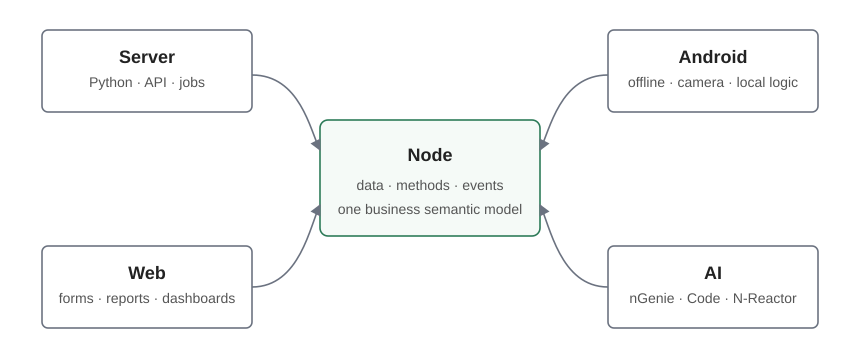
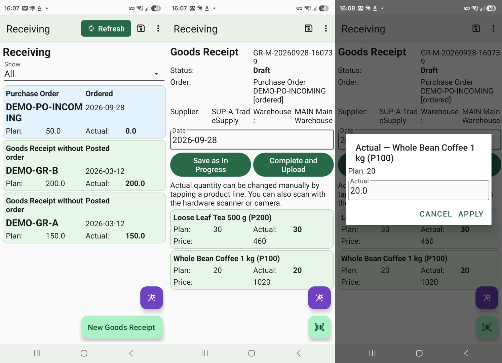
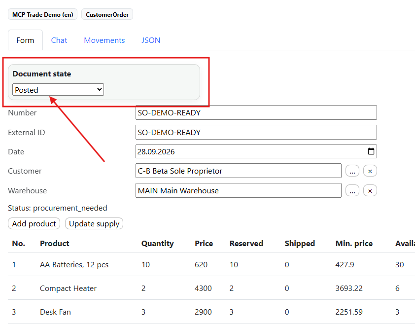
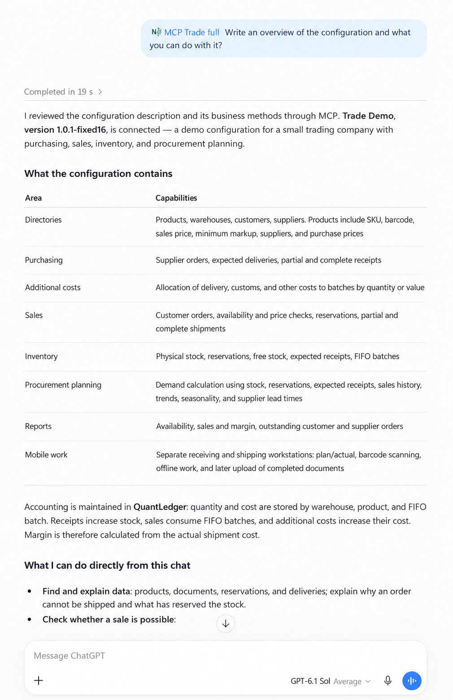
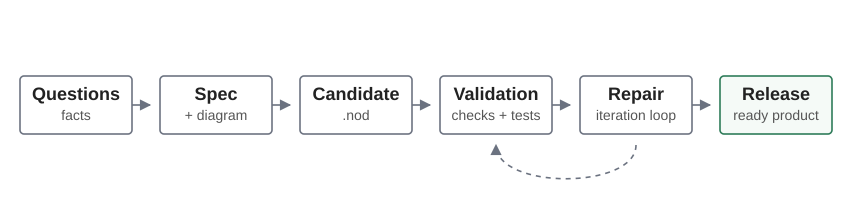

# NodaLogic

**A low-code platform for business applications with server logic, a web client and an autonomous Android runtime.**

[Try the configurator](https://nmaker.pw/) · [Documentation](https://nodatxt.readthedocs.io/en/latest/) · [Examples](Samples/)

NodaLogic builds applications around one unit: the **node**. A node combines persistent data, class methods, events, an interface and links to other nodes. Documents, products, warehouse bins and tasks use the same application model.

A solution is a portable `.nod` configuration: class descriptions, JSON-based layouts and handlers. The same configuration describes server and client behavior, with handlers assigned to the appropriate runtime. You can develop it manually, with an LLM or with the N-Reactor service, then inspect, modify and deploy the result on your own infrastructure.

## Where it fits

Warehouse and inventory systems, manufacturing operations, transport and field service, barcode workflows, and mobile workplaces connected to 1C or another ERP. NodaLogic provides application mechanisms; each configuration defines the actual business rules.

## Server, web and Android

| Runtime | How it works |
| --- | --- |
| Server | Shared business logic, storage, API, background jobs and integrations. |
| Web | Online workplaces, documents and reports; Python business handlers execute on the server. |
| Android | Local data and local handlers, including offline operation; exchange with the server follows the configuration's workflow. |

The Android client is an independent runtime. For example, a warehouse operator can download tasks and reference data, scan goods and fill documents locally, then upload the result when a connection is available. Online handlers remain available for operations that need the server or an external system.

A client can use several configurations. Configurations can be transferred as files or loaded from a repository, including by QR code. After moving a solution, configure its server addresses and Room aliases for the new installation.

*The English Trade Demo mobile workspace: receiving tasks, document entry and actual quantities.*

## Platform capabilities

### Nodes, data and accounting

- **Nodes and classes.** JSON-compatible state in `_data`, methods, events, references and hierarchies. An entity's data and behavior stay together.
- **Indexes and search.** Exact lookup, composite keys, text search, and class-level filters. Trigram and semantic search are available for applicable server scenarios.
- **Quant Ledger.** An optional server-side ledger for balances and movements: stock, money, reservations and other numeric resources. It provides atomic movements, accounting dimensions, reposting by operation ID and checks against negative balances. Business handlers define posting rules.
- **Access control.** User roles and row-level access rules (RLS) for the application model.

*Trade Demo: a posted customer order. The configuration defines how document state affects accounting and reservations.*

### Interface and application logic

- **Declarative layouts.** Shared layout principles for forms, lists, covers and dialogs; input fields, tables, cards, charts, HTML views and reports.
- **Events and Python handlers.** React to field changes, buttons, scans, incoming messages and lifecycle events. Execute logic locally on Android, on the NodaLogic server or through an online handler in an external system.
- **NodaScript.** A built-in language for expressions and UI event handlers in both web and Android. Use it for calculations and interaction close to the form, with Python for more involved business logic and integrations.
- **Files and photos.** Attachments, editable images, galleries, caching and transfer queues. `Files` supports local storage, the NodaLogic file server and S3; the image synchronization mechanisms described in the October 2026 release use S3.
- **Section forms and filters.** Replace a section's default list with a custom form and expose indexed fields as user filters. SVG icons and compact charts support dashboards and mobile workplaces.

### Exchange and integration

Choose an exchange mechanism for each task; they can be combined in one solution.

| Mechanism | Typical use |
| --- | --- |
| Rooms | Deliver nodes and changes to connected groups of devices. |
| Messaging | User and group conversations, node discussions, notifications and exchange between handlers. |
| Contracts | Batch delivery and incremental updates of large node collections to clients. |
| Upload queue | Queue outgoing data for delivery when a connection is available. |
| HTTP API and online handlers | Integrate with 1C/ERP or execute a remote operation without copying all its data to a device. |

### Camera and maps

**ActiveCV** connects barcode scanning, OCR and camera capture to application events. Recognition results can be checked against indexed nodes, with feedback displayed over the camera preview. Hardware barcode scanners can also feed application events on supported Android terminals.

**Android maps** use a common application API for markers, polylines and map events. OSM maps work offline from MBTiles, including vector tiles. Yandex Maps provides additional capabilities under the provider's key and license terms. Offline OSM displays routes supplied by the application; route calculation and geocoding need a separate service. Web maps can be integrated through HTML and a provider's web API.

## AI during development and inside the application

NodaLogic's repeated node structure, explicit events and compact layouts give an LLM a consistent target. Generated configurations remain editable. Ordinary application logic does not require an LLM; AI-powered functions need their configured model service.

| Tool | Purpose |
| --- | --- |
| Designer and an LLM | Create and edit configurations. [LLM.txt](LLM.txt) supplies generation instructions and examples. |
| nGenie | Work inside a running solution: find data, import documents, perform business actions and build reports using application descriptions, indexes and skills. |
| Data-level MCP server | Connect an external AI client to a deployed configuration: inspect its model, find nodes and call published business operations, subject to connection permissions. Supports owner access or operation as a selected user with roles and RLS. |
| N-Reactor | An optional commercial service on nmaker.pw that turns requirements into a configuration through specification, generation, technical and semantic checks, runtime tests and repair. |

*An external AI client reads a deployed Trade Demo through MCP and explains its business model and available operations.*

N-Reactor delivers an ordinary `.nod` file. Its hosted generation service is separate from the open-source server and configurator in this repository.

## Try a solution

1. Open [nmaker.pw](https://nmaker.pw/) and sign in or create an account.
2. Import a configuration from [Samples](Samples/), create your own in Designer, or choose a solution from the site's **Demo products** catalog.
3. Open the web client. For mobile workflows, install NodaLogic from [Google Play](https://play.google.com/store/apps/details?id=com.dv.noda) or [RuStore](https://www.rustore.ru/catalog/app/com.dv.noda), then add the configuration through the client's repository or its QR code.
4. Configure the exchange channels used by the example: adding a configuration and subscribing to its data are separate steps. Follow the [quick start](https://nodalogic-txt-ru.readthedocs.io/ru/latest/quick_start.html) and the selected example's instructions.

The hosted **Trade Demo** demonstrates purchasing, sales, FIFO costing, reservations, procurement planning and offline mobile receiving/shipping. Its editable configuration is available through Demo products. The WMS demo illustrates bin-based warehouse operations, strategies and reporting. These are application examples, rather than automatic behavior of every configuration.

## Examples in this repository

| Topic | Configuration |
| --- | --- |
| First application | [Quick start](Samples/Quick%20start.nod) |
| Web client | [Web Client](Samples/Web%20Client.nod) |
| Local and server nodes | [Working with nodes locally and in the cloud](Samples/Working%20with%20nodes%20locally%20and%20in%20the%20cloud.nod) |
| NodaScript | [English](Samples/config_NodaScript_EN.nod), [Russian](Samples/config_NodaScript_RU.nod) |
| Balances and movements | [Quant Ledger](Samples/quant_ledger_demo.nod) |
| Camera and recognition | [ActiveCV](Samples/config_ActiveCV.nod) |
| Messages and discussions | [Chat samples](Samples/config_Chat%20samples.nod) |
| Files and media | [Media demo](Samples/NodaLayout_Media_Demo_final.nod) |
| Custom section form | [Section form](Samples/Demo_Section_Form.nod) |
| Offline OSM / Yandex maps | [OSM](Samples/OSMMap_Demo_offline_final.nod), [Yandex](Samples/YandexMap_Demo_final.nod) |

## Repository and self-hosting

- [NodaLogicDesigner](NodaLogicDesigner/) — Python/Flask server, configurator, web client, API and communication mechanisms.
- [Samples](Samples/) — example `.nod` configurations.
- [LLM.txt](LLM.txt) — instructions for configuration generation.
- [static_readme](static_readme/) — illustrations for this overview.

Self-hosting requires a Python environment compatible with [requirements.txt](NodaLogicDesigner/requirements.txt), installation-specific settings and the services used by your solution. The full entry point is [app.py](NodaLogicDesigner/app.py); the repository also contains [short_app.py](NodaLogicDesigner/short_app.py). Review the selected entry point and its dependencies before deployment: the current snapshot requires manual setup, and the hosted nmaker.pw service includes additional components. See [self-hosting notes](docs/self-hosting.md).

The Android app is distributed separately through the stores and the [APK links on nmaker.pw](https://nmaker.pw/#apk-releases-title).

## Documentation and community

- [Documentation: English](https://nodatxt.readthedocs.io/en/latest/) · [Russian](https://nodalogic-txt-ru.readthedocs.io/ru/latest/) · [Russian documentation sources](https://github.com/dvdocumentation/nodalogic_txt_ru)
- [Platform overview](https://nmaker.pw/articles/en/platform-overview/)
- [UI, files and section forms](https://nmaker.pw/articles/en/nodalogic_uiux_575_en/) · [Offline OSM maps](https://nmaker.pw/articles/en/osm_maps/)
- [Trade Demo walkthrough](https://nmaker.pw/articles/en/trade-demo/)
- [Data-level MCP](https://nodalogic-txt-ru.readthedocs.io/ru/latest/mcp.html) · [Synchronization](https://nodalogic-txt-ru.readthedocs.io/ru/latest/sync.html)
- [Videos](https://www.youtube.com/playlist?list=PLsvLZ7PBE6oJ8WMgAMa9UJctlXDE8UJIz) · [News](https://t.me/thinknodes_ru) · [Developer community](https://t.me/nodalogic_dev)

## License

This repository is licensed under [GPL-3.0](LICENSE). The Android application, external model and map services, and the hosted N-Reactor service have their own distribution or service terms.
